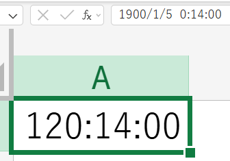
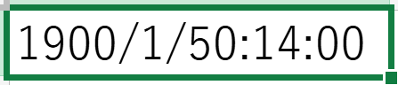

# 文字列で保存された時刻を扱う
キーワード: hhh:mm

> 本ページでは、勤務時間などの時刻データが文字列形式でDBに保存されている場合の扱い方について解説します。

### ０．はじめに

みなさんは、勤務時間などの時刻データが文字列形式でDBに保存されており、Excel等に張り付けた際、謎の空白が原因で上手く貼り付けられなかった経験はありますでしょうか？
そもそも、時刻データが文字列形式で保存されている場合、 `hhh:mm` となるように、 `CHAR(6)` で保存されていることが多く、**100時間未満の場合は先頭に`半角スペース`が付いてデータ出力されてしまう**のです。


Excel上で<strong>`半角スペース`</strong>を削除すればいいのでは？と思うかもしれませんが、24時間を超えるデータをExcelに張り付けた場合、以下のように `datetime型` になってしまうので、おかしなデータになってしまう恐れがあります。



上記のデータを<strong>`半角スペース`</strong>を削除すると・・・



このように、こちらが意図しないデータになってしまいます。

今回は、**2パターン**解説するので、理解しやすい方法を活用しましょう！

### ① 置換

REPLACEを使用して、出力時に<strong>`半角スペース`</strong>を削除するパターンです。
①さえ押さえておけば、業務上は問題ないですが、②についても理解しておくと良いと思います。

```sql
REPLACE(work_time, ' ', '')

-- → 78:30
```

### ② 時刻を日数に変換して計算

なぜ日数に変換するのか？と思った方もいるかもしれませんが、実はExcelでは、日数として持っている値に**時刻の表示形式を適用**するだけで、時刻として表示させることができるのです。
今回のケースでは、 `分表示に変換→日数表示に変換` を行っています。

■ 前半部分
① `LEFT関数`を使って、 `hhh:mm`  の `時間(hhh)` を抽出
② ①を<strong>`小数点型`</strong>に変換
③ ②を分単位に変換

■ 後半部分
① `RIGHT関数`を使って、 `hhh:mm`  の `分(mm)` を抽出
② ①を<strong>`小数点型`</strong>に変換

前半部分と後半部分を足し、1440分（24時間を分に変換）で割って、日数に変換

```sql
,(CAST(LEFT(work_time, 3) AS float) * 60 + CAST(RIGHT(work_time, 2) AS float)) / 1440

-- → 3.270833333333…
```

今回の注意点は、**データ型を小数点型にする**ということです。
もし、整数型にしてしまうと、計算結果も整数型になってしまい、今回の場合だと `3` が出力されてしまうので、気を付けましょう。
